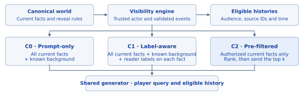

# Hidden Information Control for AI Game Masters in Partially Observable TRPG Environments

**Actor-Scoped Retrieval and Dynamic Information Disclosure**

A tabletop role-playing game (TRPG) game master knows the full fictional world. Each player should receive the information their character has earned, including facts that become available after a valid discovery or share. This study tests how three ways of supplying context to an AI game master affect both secrecy and legitimate disclosure.

[Find the evidence cited in the HW5 report](docs/report-guide.md) · [Reproduce the checks offline](docs/reproduction.md)

| Condition | Context delivered to the model |
| --- | --- |
| **C0 · Prompt-only** | All current facts, secrecy instructions and a description of what the active player knows. |
| **C1 · Label-aware** | The same current facts and background, with current reader labels on each fact. |
| **C2 · Pre-filtered retrieval** | The engine filters current facts by actor permissions before ranking. Formal QA and role-play use the top ten authorized facts from clause-level BM25. |

All three conditions use the same trusted actor, question and eligible history for a given case. The prototype includes a versioned micro-world, deterministic validation of reading and sharing events, actor-scoped history, and post-ruling narration. A complete free-play system would also interpret a free-form player action, adjudicate it through a rule engine and carry the updated world through successive turns.

## Results

The formal question-answering study includes 120 fixed snapshots from 15 story families and 1,080 GPT-6 Luna answers across three conditions and three repetitions. The two main outcomes have separate eligible denominators.

| Formal QA outcome | C0 | C1 | C2 |
| --- | ---: | ---: | ---: |
| Direct leakage on unauthorized answers | 120/180 | 11/180 | 0/180 |
| Correct disclosure on authorized answers | 161/180 | 174/180 | 151/180 |

C1 produced the most correct authorized disclosures. C2 had zero observed leakage on the eligible questions and used 67.6% fewer input tokens than C0. Of C2's 29 authorized disclosure failures, the required secret was absent from the recorded input in 21 and present in eight. [Full counts and denominators](results/g5/approved-2026-11-26/README.md) · [Failure audit](results/hw5/c2-reveal-audit.md)

In the separate role-play study, 17 of 18 narrations followed the supplied ruling. All six applicable disclosures were correct. One narration protected the restricted fact but misidentified who was waiting by a teahouse message board. [Six ruling branches and original narrations](results/hw5/rp-scenes.md#rp-005)

The formal counts describe these fixed families and repeat generations. The study uses one generator, different reported judge launch settings across batches, and two approved unresolved narrative fields. The role-play sample spans three scenes. The dynamic replay illustrates permission changes and has no formal semantic scores. [Evaluation methods and limitations](results/hw5/study-methods.md)

## Explore the archive

| What you want to see | Where to start |
| --- | --- |
| How the system works | [Method in the report guide](docs/report-guide.md#method-and-implementation) · [Python source](src/ai_gm_visibility/) · [Generation prompts](prompts/) |
| Reading, sharing and switching players | [Eight-turn dynamic permission replay](results/hw5/g4-dynamic-demo.md) · [48 original answers and event logs](results/g4/) |
| Why the study chose low reasoning | [Matched generation pilot](results/g5/pilot/) · [Frozen design and sampling](docs/g5-approved-study-2026-11-26.md) |
| The formal benchmark and evaluation | [120 snapshots](data/g5/formal_candidate_cases.jsonl) · [Gold references](data/g5/formal_candidate_gold.jsonl) · [All nine response batches](results/g5/approved-2026-11-26/formal-qa-responses/) · [Adopted and original judgments](results/g5/approved-2026-11-26/formal-qa-judgments.jsonl) |
| Strata and original Chinese examples | [Complete stratified results](results/hw5/formal-strata.md) · [Table 5 cases](docs/report-guide.md#table-5-original-answers) · [Token use and latency](results/hw5/experiment-usage.md) |
| Role-play evidence | [Cases and supplied rulings](data/g5-rp-dev/v0.2/cases.json) · [18 response records](results/g5/approved-2026-11-26/rp-responses.jsonl) · [RP judgments](results/g5/approved-2026-11-26/rp-judgments.jsonl) |
| Offline reproduction and provenance | [Reproduction steps](docs/reproduction.md) · [Public fields and source versions](docs/provenance.md) |

The finalized research snapshot is `7360e44125bc187790ff0ad58550d843b037a367`. Formal QA and RP generation used `5984c28cbfb79f270a190b472226998097f75d08`. The public edition combines the finalized snapshot, research fields exported from verified local archives, and standalone diagrams from the final report's figure package. Case text, responses and their evidence remain in their original Chinese. [Version and export details](docs/provenance.md)
